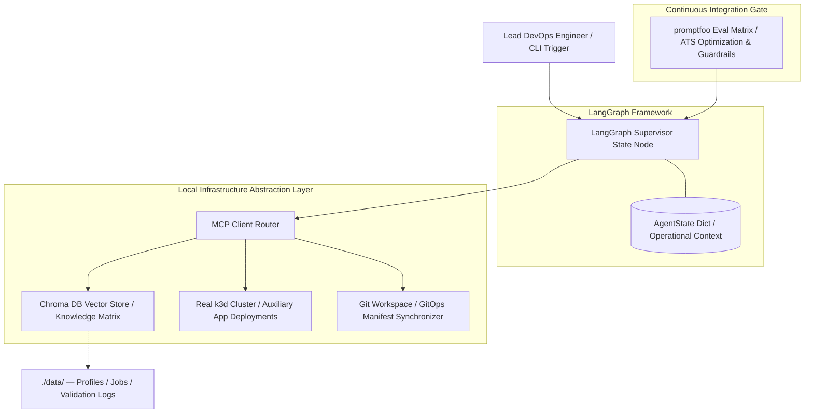

# OpenOps-Agent: Autonomous Job Search & Platform Engineering Engine

An enterprise-grade, local-first autonomous operations platform built to demonstrate production-grade **AIOps, MLOps, and Infrastructure Automation**. The architecture establishes a deterministic orchestration engine that reads professional profiles, ingests targeted job specifications, evaluates qualification gaps, and dynamically compiles tailored, ATS-compliant deployment artifacts. Concurrently, it interfaces directly with a live local **k3d Kubernetes cluster** to reconcile system workloads—operating 100% locally on a single workstation for a total infrastructure footprint of **\$0**.



## 🧠 The Engineering Philosophy: Intent-Parsing & Reconciled GitOps Loops
In a mature platform ecosystem, generative models should not be granted unconstrained, creative freedom to hallucinate configuration files. Instead, this system treats the AI as a deterministic, tool-calling **Intent-Parsing & Remediation Router**. 

By treating data assets as **Knowledge-as-Code**, career metrics and targeted job manifests are managed entirely via declarative Markdown configurations within a structured Git tree. When updates are committed to the repository, the engine executes a multi-tenant retrieval loop across **Chroma DB**, computes embeddings via local proxies, audits live environment states using custom **Model Context Protocol (MCP)** endpoints, edits local workspace layouts, and forces automated validations prior to final delivery.

---

## 🛠️ Production Architecture Stack
* **Local Inference Hub:** [Ollama](https://ollama.com) executing `qwen2.5-coder:7b` (optimized for deterministic infrastructure tool-calling) and `nomic-embed-text` vector models.
* **Orchestration Framework:** `LangChain` & `LangGraph` locked to the modern `v1.x` ecosystem for explicit state-machine design patterns, multi-node conditional routing, and human-in-the-loop validation barriers.
* **Vector Store Index:** `Chroma DB` configured via a persistent, parameters-driven, disk-backed layout for low-latency semantic analysis.
* **Systems Interfacing Node:** `Anthropic Model Context Protocol (MCP) SDK` managing isolated background `stdio` pathways to securely execute sandboxed system operations against Git layouts and Kubernetes environments.
* **Continuous Integration Test Harness:** [promptfoo](https://promptfoo.dev) for rigorous prompt assertions, schema compliance verification, and automated regression scanning.

---

## 📂 System Directory Tree
```text
.
├── pyproject.toml           # Pytest system pythonpath discovery rules
├── requirements.txt         # Version-locked package dependency manifest
├── setup.sh                 # Standardized, automated bootstrap workspace deployment utility
├── .env.example             # Network bridge and environment gateway variables template
├── data/                    # Knowledge-as-Code declarative data warehouse
│   ├── profile/             # Master profiles, core competencies, and career metrics (.md)
│   └── jobs/                # Targeted industry job descriptions (.md)
├── src/
│   ├── __init__.py          # Python namespace initialization
│   ├── agent.py             # Core LangGraph career orchestrator state machine logic
│   ├── ingest.py            # Optimized parameter-driven data ingestion and chunking engine
│   └── mcp_server.py        # Custom DevOps MCP Server executing live shell subprocesses
└── tests/
    ├── test_ingest.py       # Isolated unit test verification matrices
    └── promptfooconfig.yaml # promptfoo ATS validation assertions and prompt matrices
```

---

## 🚀 Getting Started (100% Local Deployment)

### Prerequisite Host Configuration
1. Install [Ollama](https://ollama.com) on your underlying operating system.
2. Pull down the optimized developer models from your terminal interface:
   ```bash
   ollama pull qwen2.5-coder:7b
   ollama pull nomic-embed-text
   ```
3. Initialize the target Kubernetes runtime using [k3d](https://k3d.io):
   ```bash
   k3d cluster create openops-dev-cluster
   ```

### Automated Workspace Bootstrap
Clone the platform core into your environment (WSL2 Ubuntu recommended), copy the environmental variable templates, and run the automated bootstrap shell script to establish sandboxed virtual layouts and file dependencies:

```bash
git clone https://github.com
cd openops-agent

# Set up local workspace network constants
cp .env.example .env
# Note: For WSL2 execution loops, modify OLLAMA_BASE_URL to match your Windows Host bridge IP

# Execute the local workspace creation sequence
chmod +x setup.sh
./setup.sh
```

### Executing the Testing Harness
To run the automated, network-isolated unit test suite built to protect the ingestion layer:
```bash
source .venv/bin/activate
pytest -v
```

---

## 🧪 Prompts-as-Code Validation Gate (promptfoo)
To ensure that prompt structures remain deterministic and enforce strict schema compliance without hallucinating invalid configuration parameters, evaluation models are integrated directly into our pre-merge testing hooks:

```bash
# Execute the parallel system evaluation matrix via terminal
OLLAMA_BASE_URL="http://YOUR_HOST_BRIDGE_IP:11434" promptfoo eval
```

To visually audit test results, track inputs, and inspect parameter outputs directly via a clean dashboard UI, type:
```bash
promptfoo view
```

---
*Maintained by Robert Carlson — Platform & DevOps Engineer.*