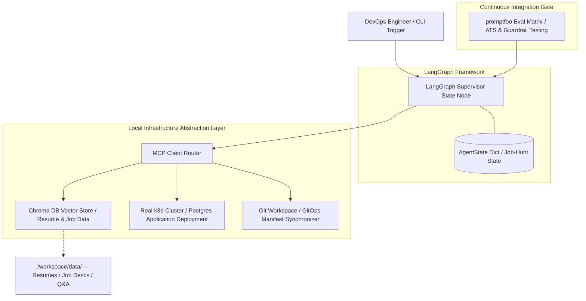

# OpenOps-Agent: Autonomous Job Search & Platform Engineering Engine

An open-source, local-first autonomous operations engine built to demonstrate production-grade **AIOps, MLOps, and Platform Engineering automation**. The system reads a personal professional profile, ingests target job descriptions inside a GitOps directory repository, analyzes qualification skill gaps, and dynamically compiles tailored, ATS-compliant application artifacts. Concurrently, it manages its own state and scheduling tracking logs by interfacing directly with a live local **k3d Kubernetes cluster**—running 100% locally on a single workstation for **\$0**.



## 🧠 The Engineering Value: Why RAG + GitOps Sync?
In a mature platform engineering environment, an LLM should not be given blind, creative freedom to hallucinate configuration files. Instead, the AI functions as a deterministic **Intent-Parsing & Remediation Loop Router**. 

By treating your career data assets as **Knowledge-as-Code**, you store standard Markdown descriptions, resumes, and question logs directly inside your infrastructure repository. When a new target target job manifest is added to the repository loop, the AI parses the raw text requirements, cross-references your qualifications via **Chroma DB**, queries its live state engine database running inside the **k3d cluster** via the **MCP Server**, updates infrastructure states by editing declarative Git layouts, and runs strict verification tests before finalizing the workspace pipeline.

---

## 🛠️ Architecture Stack
* **Local Inference Node:** [Ollama](https://ollama.com) running `qwen2.5-coder:7b` (optimized for deterministic infrastructure tool-calling) and `nomic-embed-text` vector arrays.
* **Orchestration Layer:** `LangChain` and `LangGraph` for stateful state machine design patterns, multi-node routing, and human-in-the-loop validation barriers.
* **Vector Knowledge Base:** `Chroma DB` for low-latency, persistent semantic searching of resumes, cover letter components, and job metrics.
* **Infrastructure Interface:** `Anthropic Model Context Protocol (MCP) SDK` managing background `stdio` communication channels that safely execute sandboxed shell subprocesses against Git repositories and Kubernetes clusters.
* **Continuous Integration Test Harness:** `promptfoo` for prompt assertions, security verification testing, and keyword optimization scanning before code execution loops.

---

## 📂 Repository Layout
```text
.
├── .gitignore               # System, runtime, and secret exclusion blocks
├── README.md                # Platform documentation and architecture overview
├── requirements.txt         # Python package dependencies
├── setup.sh                 # One-command automated bootstrap deployment script
├── .env.example             # Template for network interface variables
├── data/                    # Knowledge-as-Code raw data directory
│   ├── profile/             # Core master resume, tech stacks, and career logs (.md)
│   └── jobs/                # Raw targeted job description files (.md)
├── src/
│   ├── agent.py             # Core LangGraph career orchestrator state machine
│   ├── ingest.py            # Local file watcher, markdown chunker, and Chroma ingestion
│   └── mcp_server.py        # Custom DevOps MCP Server executing real system commands
└── tests/
    └── promptfooconfig.yaml # promptfoo ATS validation assertions and prompt matrices
```

---

## 🚀 Getting Started (100% Local Setup)

### Prerequisite Environment Configuration
1. Install [Ollama](https://ollama.com) on your host operating system.
2. In your host environment terminal, pull down the target developer modules:
   ```bash
   ollama pull qwen2.5-coder:7b
   ollama pull nomic-embed-text
   ```
3. Spin up a local Kubernetes cluster using [k3d](https://k3d.io):
   ```bash
   k3d cluster create openops-dev-cluster
   ```

### Installation
Clone this repository into your local workspace runtime (WSL2 Ubuntu recommended), configure your environment values, and run the automated initialization sequence:

```bash
git clone https://github.com
cd openops-agent

# Set up local workspace constants
cp .env.example .env
# Edit .env to point your WSL interface to your Windows Host bridge IP if necessary

# Execute the local workspace creation sequence
chmod +x setup.sh
./setup.sh
```

---

## 🧪 CI/CD Testing with promptfoo
To ensure that prompt structures stay consistent, handle schema declarations predictably, and never hallucinate dangerous execution parameters (such as raw `--force` or recursive deletion mutations), validation models are integrated directly into local testing matrices:

```bash
# Execute the parallel system evaluation matrix via terminal
OLLAMA_BASE_URL="http://YOUR_HOST_BRIDGE_IP:11434" promptfoo eval
```

To visually audit test results, trace inputs, and inspect parameter outputs directly via a clean dashboard UI, type:
```bash
promptfoo view
```

---
*Developed by Robert Carlson — Platform & DevOps Engineer.*